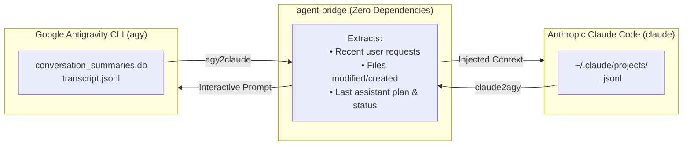

<div align="center">

# 🌉 agent-bridge

**Seamless Bidirectional Memory & Handoff Bridge between AI Coding Agents**

[](https://opensource.org/licenses/MIT)
[](https://www.python.org/downloads/)
[]()
[]()

*Switch freely between Google Antigravity CLI (`agy`) and Anthropic Claude Code (`claude`) in the same project without losing context, decisions, or modified files.*

[Italiano](#-versione-in-italiano) • [Features](#-key-features) • [Installation](#-quick-install) • [How It Works](#-how-it-works) • [Commands](#-cli-commands) • [Project Memory](#-project-level-memory)

---

</div>

## 💡 The Problem

Modern AI engineers often rely on multiple AI coding assistants depending on the task:
- **Google Antigravity CLI (`agy`)**: Incredible for planning mode (`/plan`), DeepMind research agents, background cron tasks, and Gemini 2.5 Pro/Flash models.
- **Anthropic Claude Code (`claude`)**: Exceptional for fast terminal edits, frontier reasoning with flagship models like Claude Opus 5.5 / Sonnet 5.5, and direct provider integrations (like OpenRouter).

However, **these tools live in completely isolated silos**. If you spend 20 minutes designing an architecture with Antigravity and then want Claude Code to implement parts of it, Claude knows **nothing** about your conversation, your decisions, or the files Antigravity touched.

**`agent-bridge` solves this permanently.** It inspects each agent's native session stores and allows instant, lossless handoffs in both directions.

---

## ⚡ Quick Install

Run this one-liner in your terminal (macOS or Linux):

```bash
curl -fsSL https://raw.githubusercontent.com/CheckSim/agent-bridge/main/install.sh | bash
```

Restart your terminal or run `source ~/.zshrc` (or `source ~/.bashrc`).

---

## 🚀 How It Works



1. **Workspace-Aware Discovery**: It dynamically queries the active working directory and matches it against Antigravity's SQLite store (`conversation_summaries.db`) and Claude Code's project hierarchy (`~/.claude/projects/`).
2. **Lossless Context Synthesis**: It parses turn histories, tool executions (`write_file`, `Edit`, `Bash`, `run_command`), and user requests into a compact briefing.
3. **Native Injection**: It feeds the context directly into the target agent's CLI interface without patching binaries or creating brittle hacks.

---

## 🛠 CLI Commands

### 1. Handoff from Antigravity to Claude Code
```bash
agy2claude [optional instruction...]
```
Extracts your latest Antigravity session in the current project and launches Claude Code with the full context injected into its system prompt.

*Example:*
```bash
agy2claude "Now implement unit tests for the components we designed"
```

### 2. Handoff from Claude Code to Antigravity
```bash
claude2agy [optional instruction...]
```
Extracts Claude Code's latest session, created/modified files, and shell executions, then launches Antigravity CLI in interactive mode acknowledging the work done.

*Example:*
```bash
claude2agy "Review Claude's changes and create a plan for deployment"
```

### 3. Check Workspace Memory Status
```bash
agent-status
```
Prints an instant overview of both agents' latest activity in the current directory:

```text
=== AGENT BRIDGE STATUS ===
Workspace: /Users/username/Projects/my-app

[Antigravity CLI (agy)]
  * ID: b1707598-7988-4b09-927f-332cfb31036f
  * Title: Backend Architecture Refactor
  * Last Modified: 2026-10-24 15:40:12
  * Recent Files: write_file: server.py, edit_file: config.json

[Claude Code (claude)]
  * Session ID: 341e874b-e8ee-4e24-8f9b-4e7cc6a2213e
  * Last Modified: 2026-10-24 15:52:45
  * Recent Files: create: test_server.py
```

### 4. Dry-Run Mode
Inspect what briefing will be passed before running:
```bash
agy2claude --dry-run
claude2agy --dry-run
```

---

## 🧠 Project-Level Memory (`AGENTS.md`)

`agent-bridge` installs a universal skill called **`cross-agent-memory`** for both Antigravity and Claude Code.

By convention, if you place an `AGENTS.md` (or `CLAUDE.md`) in your project root:
* **Both agents** will read it automatically before executing tasks.
* **Both agents** will record major architectural decisions and coding standards into it.

---

## 🇮🇹 Versione in Italiano

**agent-bridge** è un'utilità da riga di comando autonoma (zero dipendenze esterne) che colma il divario tra gli agenti di sviluppo AI:
* Permette di passare da **Antigravity CLI** a **Claude Code** (e viceversa) continuando esattamente dal punto in cui ti sei fermato.
* Nessun bisogno di rispiegare il contesto, l'architettura o i file modificati.
* Include un installer a riga singola per macOS e Linux.

```bash
# Installazione rapida
curl -fsSL https://raw.githubusercontent.com/CheckSim/agent-bridge/main/install.sh | bash

# Comandi principali
agy2claude    # Da Antigravity a Claude
claude2agy    # Da Claude ad Antigravity
agent-status  # Stato della memoria nel workspace
```

---

## 🔮 Roadmap & Extensibility

`agent-bridge` is designed with a pluggable adapter architecture. Future updates will include:
- [ ] Support for **OpenCode / Codex CLI**
- [ ] Support for **Aider** git-based handoffs
- [ ] Auto-commit synchronization between agent handoffs
- [ ] Local web dashboard for visual session history

---

## 📄 License

Created by **Simone Cecconi ([@CheckSim](https://github.com/CheckSim))**.  
Released under the [MIT License](LICENSE).
